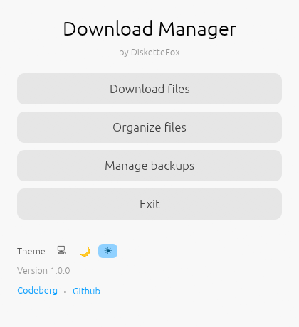
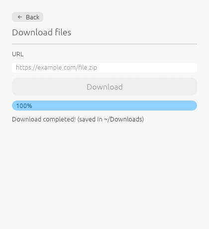
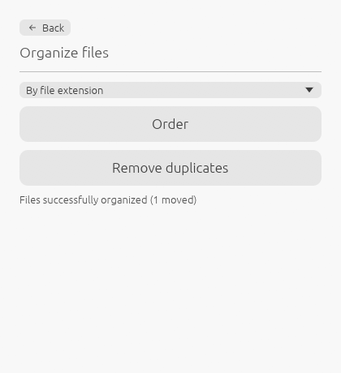
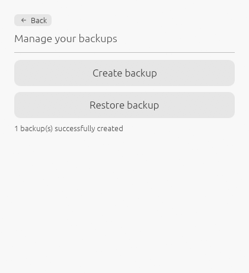

<image src="./docs/images/icon.png" height="150" />

<h1 align="center">Downloads Manager</h1>

A **Rust** program made with [egui](https://github.com/emilk/egui) that manages downloads from links, handles backups, and organizes files in a download folder.

## Features

- Downloading files from url
- Managing backups
- Organizing files
- Delete duplicates

## Screenshots

    

        
        
    

    

        
        
    

## License

Licensed under the [AGPLv3](https://www.gnu.org/licenses/agpl-3.0.en.html) license.